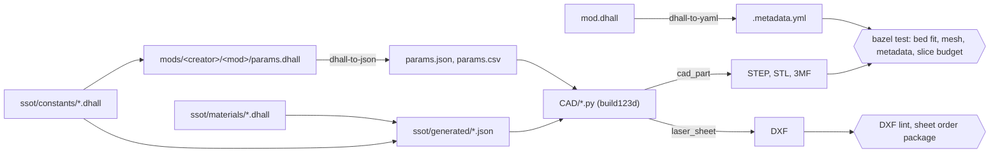

# Architecture

One rule organises the repository: hand-edit Dhall and Python, generate everything else, and test what you generate.

## Flow



`just ssot-render` writes every generated file. `just ssot-check` re-renders and fails when a committed output is stale or untracked.

## Layout

| Path | Holds |
|---|---|
| `ssot/types/` | Dhall schema: Mod, Material, LaserVendor, LaserSku, SheetOrder |
| `ssot/constants/` | Glands, inserts, fasteners, rack sizes, printers and the sheet vendor, each with a `source` |
| `ssot/materials/` | Strength, layer ratio, modulus, heat deflection, clearance and kerf per material |
| `mods/<creator>/<mod>/` | One part family: `mod.dhall`, `params.dhall`, `CAD/*.py`, `BUILD.bazel`, exports |
| `tools/fab/` | build123d feature library: bosses, teardrop gland holes, gasket groove and bead, cable saddle, TPU skins, PCB bay |
| `tools/bazel/` | Macros `cad_part`, `bed_fit_test`, `laser_sheet`, `sheet_order_test`, `slice_check`, `metadata_test` |
| `tools/print/` | `mesh_check.py` (naming, binary STL, watertight, bed fit) and `slice_report.py` |
| `tools/laser/` | `dxf_lint.py` (vendor hole, web and neck rules) and `sheet_quote.py` (order package) |
| `tools/ssot/` | Render, type check, freshness check and renderer tests |
| `tools/template/` | `stamp.sh`, which stamps a new repository |

Printers and the sheet vendor in `ssot/constants/` are examples. A new repository replaces them with its own machines and its vendor's published data before it trusts a bed fit or orders a part.

## Constants discipline

- Every constants record carries a `source` field: a URL, a drawing or a measurement.
- A value not checked against its primary source says UNVERIFIED in its `source` or note.
- Parts import constants in `params.dhall` instead of copying numbers.
- Print a coupon cut from the real part before printing the part (`tools/fab/coupon.py`).

## Private overlay

Agent tooling stays on a contributor's fork. The public tree renders and passes `just ssot-check` without it.

A fork may add Dhall sources for its own agent files under `ssot/.agents/`, with up to four hook scripts there:

| Script | Called by | Does |
|---|---|---|
| `render.sh` | `tools/ssot/render.sh`, sourced last | renders the overlay outputs |
| `paths.sh` | `tools/ssot/lib.sh` | lists the overlay outputs for the freshness check |
| `type.sh` | `tools/ssot/type.sh` | type-checks the overlay sources |
| `check.sh` | `tools/ssot/check.sh` | any extra check the overlay needs |

`.gitignore` lists `ssot/.agents/` and the files it renders, and the pre-push hook refuses them, so they never reach the organization repository. Keep them on the `agents-overlay` branch of your fork, as the contributing guide describes, and copy them into a clone before `just ssot-render`:

```sh
git fetch origin agents-overlay
git archive origin/agents-overlay | tar -x -f -
just ssot-render
```

## Checks that need more than Python

| Check | Needs |
|---|---|
| `cad_part`, `features_test`, `lib_test`, the mod tests | build123d (Bazel installs it from `tools/python/requirements_lock.txt`) |
| `slice_check` | OrcaSlicer and a profile under `third_party/slicer_profiles/` |
| `ssot_test` | dhall, dhall-json, jq and yq from the devShell |
